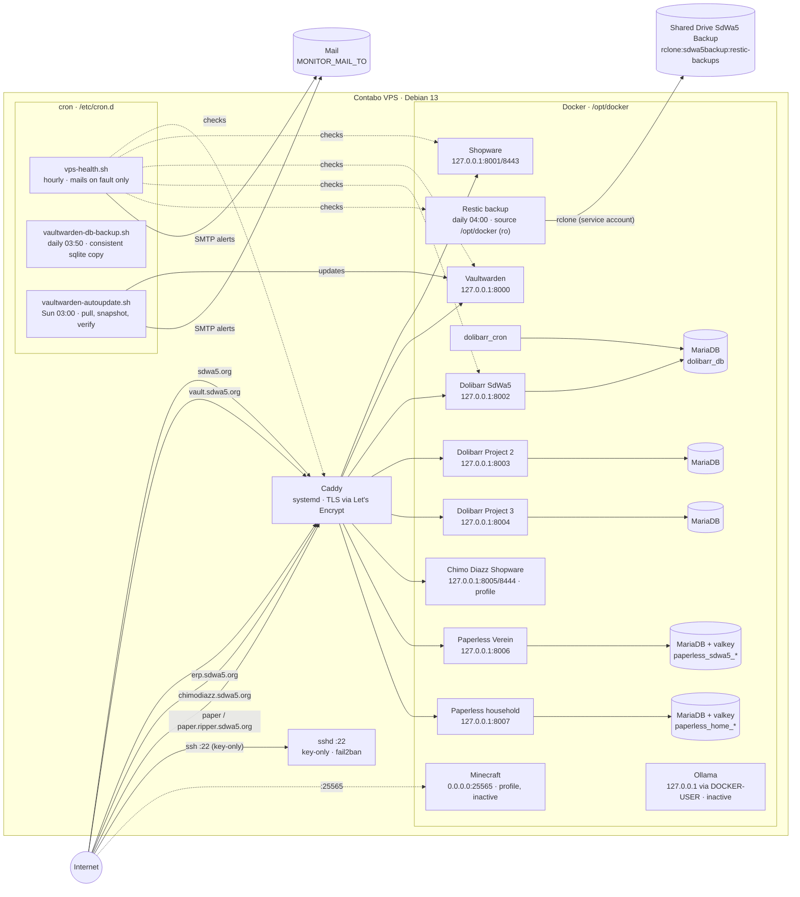

# SdWa5 VPS Infrastructure

Contabo VPS · Debian 13 (trixie) · all services in `/opt/docker/`

## Overview diagram



Domain → port mapping lives in the [Caddyfile](../Caddyfile); backup detail in
[backup.md](backup.md).

## Stack overview

| Service             | Image                        | Port (internal) | Public URL                 | Compose file                            |
|---------------------|------------------------------|-----------------|----------------------------|-----------------------------------------|
| Shopware            | dockware/shopware:6.7.15.1   | 8001 / 8443     | https://sdwa5.org          | docker-compose.yml                      |
| Vaultwarden         | vaultwarden/server:latest    | 8000            | https://vault.sdwa5.org    | docker-compose.yml                      |
| Dolibarr SdWa5      | dolibarr/dolibarr:24.0.1     | 8002            | https://erp.sdwa5.org      | docker-compose.yml                      |
| Dolibarr SdWa5 cron | dolibarr/dolibarr:24.0.1     | —               | —                          | docker-compose.yml                      |
| Chimo Diazz         | dockware/shopware:6.7.11.1   | 8005 / 8444     | https://chimodiazz.sdwa5.org | docker-compose.projects.yml (profile: chimodiazz) |
| Paperless Verein    | paperless-ngx:3.3.2 + mariadb:12.3 + valkey:9.0 | 8006 | https://paper.sdwa5.org | docker-compose.yml          |
| Paperless household | paperless-ngx:3.3.2 + mariadb:12.3 + valkey:9.0 | 8007 | https://paper.ripper.sdwa5.org | docker-compose.yml   |
| Ollama              | ollama/ollama:latest         | 11434           | (no domain, firewalled)    | docker-compose.yml                      |
| Restic backup       | creativeprojects/resticprofile | —               | —                          | docker-compose.yml                      |
| Minecraft           | itzg/minecraft-server:latest | 25565           | —                          | docker-compose.yml (profile: minecraft) |

Cron jobs (host, not Docker) — see [monitoring.md](monitoring.md):

| Job                        | Script                                  | Schedule       |
|----------------------------|-----------------------------------------|----------------|
| Health check               | `monitoring/vps-health.sh`              | hourly, `:17`  |
| Vaultwarden database copy  | `monitoring/vaultwarden-db-backup.sh`   | daily 03:50    |
| Vaultwarden auto-update    | `monitoring/vaultwarden-autoupdate.sh`  | Sunday 03:00   |
| Shopware worker (x2)       | `monitoring/shopware-worker.sh`         | every minute   |
| Chimo Diazz deploy         | `monitoring/chimodiazz-deploy.sh`       | every five minutes |

Reverse proxy: **Caddy** (systemd service, not in Docker) — see [caddy.md](caddy.md)

Host access: **sshd on :22, key-only** since 2026-09-07, with fail2ban. See
[ssh-hardening.md](ssh-hardening.md).

**The host is default-deny on both IP families** since 1.11.0, and this paragraph said the opposite
until 2026-09-13. Measured on the live host on that date: `iptables -P INPUT DROP` and
`ip6tables -P INPUT DROP`, with `22`, `80` and `443` the only accepted inbound ports, fail2ban's jump
at the head of `INPUT`, and `DOCKER-USER` dropping everything arriving from `eth0` toward a container
except `25565`. So a container that publishes on `0.0.0.0` is **not** reachable from outside unless
[`hardening/firewall/sdwa5-firewall.sh`](../hardening/firewall/sdwa5-firewall.sh) names its port, which
is the whole point of that chain.

## Container isolation

Each application has a Docker network of its own since 2026-10-15. Before that every container sat
on `docker_default`, and measured that night, `chimodiazz_shopware` opened `shopware:3306`,
`dolibarr_db:3306`, `vaultwarden:80` and `dolibarr:80` by name, and logged into the main shop's
database as dockware's `root`/`root`.

| Network | Members | Note |
|---|---|---|
| `vault` | vaultwarden | |
| `shop` | shopware | |
| `erp` | dolibarr, dolibarr_cron | Egress for mail and the PayPal API |
| `erp_db` | dolibarr_db, dolibarr, dolibarr_cron | `internal`, so the database has no gateway |
| `paper_sdwa5` | paperless_sdwa5 | Paperless-ngx Verein, see [paperless.md](paperless.md) |
| `paper_sdwa5_db` | paperless_sdwa5_db, paperless_sdwa5_broker, paperless_sdwa5 | `internal` |
| `paper_home`, `paper_home_db` | the household instance | Same shape as the Verein instance |
| `backup` | restic | Egress to Google Drive |
| `chimodiazz` | chimodiazz_shopware | Third-party theme code runs here |
| `minecraft`, `ollama` | profile-gated services | |

Docker keeps user-defined bridges apart, so a container reaches only its own application. Caddy is
unaffected, because it runs on the host and talks to the loopback publishes. A container cannot reach
another application's loopback publish through its gateway either, since those listen on `127.0.0.1`
only. The host firewall no longer accepts the bridges in `INPUT`, so a container reaches the host on
22, 80 and 443 only, the same as anyone on the internet. Nothing needed more. Mail goes to
the Workspace relay `smtp-relay.gmail.com`, or for `chimodiazz_shopware` to its own in-container
mailcatcher, and DNS is Docker's embedded resolver.

Every running service also drops `NET_RAW`, which takes away raw sockets and with them ARP and ICMP
tricks on its bridge.

Measured after the cutover on 2026-10-15. From `chimodiazz_shopware`, `shopware` and `dolibarr`,
every port of every other application was closed by IP. The one open path was `dolibarr` to
`dolibarr_db:3306`. The gateway answered on 22, 80 and 443 and refused 25, 2019, 3306, 8000, 8002,
8443 and 33113. DNS and HTTPS egress worked in both shops, in Dolibarr, in vaultwarden and in restic,
and `dolibarr_db` had no egress at all. All sites answered as before, the database dumps and their
restore checks passed for all three databases, and `vps-health.sh` reported no fault. The cutover
recreated the containers in ca. 2 minutes. `monitoring/security-recheck.sh` repeats this matrix, see
[monitoring.md](monitoring.md#security-recheck).

### Database accounts

Each dockware shop connects with an account of its own, `shopware@localhost`, limited to its own
database. [`hardening/dockware-db-account.sh`](../hardening/dockware-db-account.sh) creates it,
rewrites `DATABASE_URL` in the shop's `.env` and drops `root@'%'`. The password exists only in that
`.env`, which sits in the html volume restic backs up. The backup jobs read the same `DATABASE_URL`,
so they follow without a change.

**`root@localhost` keeps dockware's default password, and that is deliberate.** dockware's entrypoint
runs `update_domain.sh` on every start, that script logs in as `root`/`root` over `127.0.0.1`, and the
entrypoint runs under `set -e`. A changed root password would therefore stop the shop from booting.
The remote root is what mattered, and with `root@'%'` gone a root login works only from inside the
container, where the shop's own `.env` already grants full access to its database. Tested on a
throwaway container before the live change: after the script and a restart, dockware booted, its
boot script updated the domain as `root@localhost`, and the storefront answered 200. Both live shops
booted the same way on the new networks. The `ERROR 1062 ... Duplicate entry` line in their boot log
is `update_domain.sh` inserting a domain that already exists, so it shows the root login worked and
the boot continued.

`dolibarr_db` had a `root@'%'` as well, from the MariaDB image's default `MARIADB_ROOT_HOST`. It is
dropped, and Dolibarr keeps using its own `dolidbuser`.

A dump restored into an existing shop container keeps the account, because the dump carries the
shop database and not the `mysql` schema. A shop rebuilt from a fresh dockware image needs the script
again, as step 4 in [chimodiazz.md](chimodiazz.md#how-it-was-brought-up) does.

### Secrets

Since 2026-10-16 the passwords and keys of Dolibarr, Paperless and restic are compose file secrets
rather than `.env` values, see the `secrets:` block of [docker-compose.yml](../docker-compose.yml).
Each is a file in `/opt/docker/secrets/` (directory 700, files 400, root, no trailing newline,
gitignored), bind-mounted read-only at `/run/sdwa5-secrets/<name>`, and
[`tools/secrets/write-secret-files.sh`](../tools/secrets/write-secret-files.sh) writes them. They no
longer appear in `docker inspect` or `docker compose config`. Whether a value still reaches a
process environment depends on how the image reads its `*_FILE`, and no image was assumed to support
one without reading its entrypoint:

| Service | Reads | Where the value still is |
|---|---|---|
| `dolibarr`, `dolibarr_cron` | `DOLI_*_FILE` through the entrypoint's `get_env_value`, into a shell variable | `conf.php` (database password, 400 `www-data`); `/etc/cron.d/dolibarr` (644) and the `cron_run_jobs.php` command line (cron key) |
| `dolibarr_db`, `paperless_*_db` | `MYSQL_*_FILE` through MariaDB's `file_env` | the file only; `mariadbd`'s environment carried none on 2026-10-16 |
| `paperless_sdwa5`, `paperless_home` | `PAPERLESS_*_FILE` through the s6 `init-env-file`, which copies the value | `/run/s6/container_environment/` and the environment of every Paperless process |
| `restic` | `RESTIC_PASSWORD_FILE`, read by restic itself | the file only |

Vaultwarden's `ADMIN_TOKEN` stays in `.env`, because it is an argon2id hash rather than the token.
The dockware shops carry no secret in their container environment, since dockware's `SSH_PWD`,
`TIDEWAYS_KEY` and `SW_API_ACCESS_KEY` hold the literal `not-set`. Their database passwords are in
each shop's `.env` in the html volume, see the database accounts above. `monitoring/security-recheck.sh`
reports per container which secret names `docker inspect` or a process environment still carries,
see [monitoring.md](monitoring.md#security-recheck).

### No sshd in the shop containers

dockware is a development image, and its entrypoint starts `sshd` with password login for `root` and
`dockware` and `mailcatcher` on every boot. Neither port was published, but an application container
has no use for `sshd`, and access goes through `docker exec`, as the CIS Docker Benchmark asks.
[`hardening/dockware-boot-end.sh`](../hardening/dockware-boot-end.sh) is mounted read-only as
dockware's own end-of-boot hook `/var/www/boot_end.sh` into both shops. It stops `sshd` in both and
`mailcatcher` in the sdwa5.org shop, which sends through `core.mailerSettings`. `chimodiazz_shopware`
keeps `mailcatcher`, because its mail still falls back to `.env`'s `MAILER_DSN=smtp://127.0.0.1`
and lands there, see [chimodiazz.md](chimodiazz.md). Tested on a bare `dockware/shopware:6.7.15.1`
on 2026-10-16, where the container booted, `sshd` was gone in both variants and `mailcatcher` only
where the flag was set. A production image instead of dockware would remove both for good, see
[TODO.md](../TODO.md).

## Directory layout (`/opt/docker/`)

```
/opt/docker/
├── docker-compose.yml              # main services
├── docker-compose.projects.yml     # Chimo Diazz Shopware (profile-gated)
├── .env                            # settings, Vaultwarden's ADMIN_TOKEN hash — NEVER commit
├── secrets/                        # gitignored — compose file secrets, 700/400 root
├── .env.example                    # template for .env
├── Caddyfile                       # Caddy reverse proxy config (copy for ref)
├── docker/
│   ├── nginx/                      # empty (unused)
│   └── php/                        # empty (unused)
├── docs/                           # this documentation
├── hardening/                      # host SSH and fail2ban config, deployed to /etc
│   ├── sshd_config.d/10-hardening.conf
│   ├── fail2ban/jail.local
│   ├── dockware-boot-end.sh        # mounted into both shops as /var/www/boot_end.sh
│   └── dockware-db-account.sh      # gives a dockware shop its own database account
├── monitoring/                     # host cron scripts, deployed to /opt/docker/monitoring
├── vaultwarden-db-backup/          # gitignored — consistent sqlite copy for restic
├── shopware-html-data/             # partially tracked — Shopware web root + MySQL
│   ├── composer.json/.lock, symfony.lock, config/*   # tracked — all eleven plugins are locked here
│   └── .env, auth.json, var/, vendor/, public/, files/, custom/, config/jwt/
│                                                      # gitignored (secrets/build/uploads)
├── shopware-mysql-data/            # gitignored
├── shopware-data/                  # gitignored (legacy mount)
├── dolibarr-mariadb-data/          # gitignored — Dolibarr SdWa5 DB
├── chimodiazz-placeholder/         # tracked — maintenance page, not currently routed
├── chimodiazz-src/                 # gitignored — checkout of chimodiazz/website (own deploy key)
├── chimodiazz-html-data/           # gitignored — Chimo Diazz Shopware web root
├── chimodiazz-mysql-data/          # gitignored — Chimo Diazz Shopware DB
├── dolibarr-documents-data/        # gitignored — Dolibarr SdWa5 uploads
├── dolibarr-custom-data/           # gitignored — only GeoLite2-Country.mmdb (MaxMind, re-downloadable)
├── vaultwarden-data/               # gitignored — Vaultwarden data
├── paperless-{sdwa5,home}-data/    # gitignored — Paperless index, classifier, logs
├── paperless-{sdwa5,home}-media/   # gitignored — Paperless originals and archive files
├── paperless-{sdwa5,home}-mariadb-data/  # gitignored — Paperless DBs
├── tools/paperless/                # Paperless dev mirror, setup and visibility check
├── tools/secrets/                  # writes the compose file secrets
├── ollama-data/                    # gitignored — Ollama model cache
├── minecraft-data/                 # partially tracked — Minecraft world data
│   ├── server.properties.example, eula.txt, ops.json, whitelist.json, banned-*.json, config/  # tracked
│   ├── server.properties           # gitignored — holds generated secrets, see minecraft.md
│   │   (except config/Discord-Integration.toml — contains the bot token, stays gitignored)
│   └── world/, backup/, mods/, logs/, versions/, libraries/, cache/   # gitignored (data/rebuildable)
└── rclone-config/                  # gitignored
    ├── restic-sa.json              # service account key of the restic remote, mode 600
    └── rclone.conf                 # empty since 2026-10-15, the remote lives in docker-compose.yml
```

## Memory & swap

5.8 GiB RAM. Two-tier swap: compressed zram first, swapfile as overflow.
Verified live 2026-07-04 on kernel 6.1.0-47-cloud-amd64, and again on 2026-10-15 on
6.1.0-53-cloud-amd64 after the reboot into it.

```
NAME       TYPE      SIZE  USED PRIO
/dev/zram0 partition 3,5G 11,8M  100
/swapfile  file        6G 63,6M   -2
```

- **zram** via `zram-tools` package (`zramswap.service`, enabled).
  Config `/etc/default/zramswap`: `ALGO=zstd`, `PERCENT=60` → 3.5G device.
  Priority 100 → kernel swaps here first.
- **Swapfile** `/swapfile` 6G, `/etc/fstab` entry `/swapfile none swap sw 0 0`,
  priority -2 → only used when zram is full.
- **No zswap** — the Debian cloud kernel is built without it
  (`CONFIG_ZSWAP is not set` in `/boot/config-6.1.0-53-cloud-amd64`), so zram
  is the only in-RAM compression option here.
- Sysctls at Debian defaults: `vm.swappiness=60`, `vm.page-cluster=3`.

```bash
# inspect
zramctl
swapon --show
systemctl status zramswap
```

## Common operations

```bash
# start all main services
cd /opt/docker && docker compose up -d

# restart single service
docker compose restart shopware

# view logs
docker compose logs -f shopware

# reload Caddy config
systemctl reload caddy

# clear Shopware cache
docker exec shopware php bin/console cache:clear
```

## Notes

- Ollama binds `0.0.0.0:11434` and has no auth, **and the firewall is what stops that mattering**.
  `DOCKER-USER` drops anything arriving from `eth0` toward a container unless the port is named there,
  and `11434` is not. Measured 2026-09-13: the container is profile-gated and nothing is listening on
  that port at all. Rebinding to `127.0.0.1:11434` in `docker-compose.yml` would make the container
  safe on its own rather than safe by the chain around it, and it is still worth doing before Ollama is
  ever started again.
- `docker/nginx/` and `docker/php/` dirs exist but are empty — historical artifact from initial setup.
- `shopware-data/` is a legacy volume mount, unused since migration to `shopware-html-data/`.
- Minecraft is fully configured but excluded from default `up` via compose profile `minecraft`;
  `minecraft-data/` persists the world.
- `shopware-html-data/` and `minecraft-data/` are no longer fully gitignored — see the tree above for which
  subpaths are tracked. No plugin source is among them. Since 2026-10-01 all eleven plugins on `sdwa5.org`
  are exact requires in `composer.json` and install into `vendor/`. The three from the Shopware Store need
  the token in `shopware-html-data/auth.json`. The inventory is [shopware/plugins.md](shopware/plugins.md).
